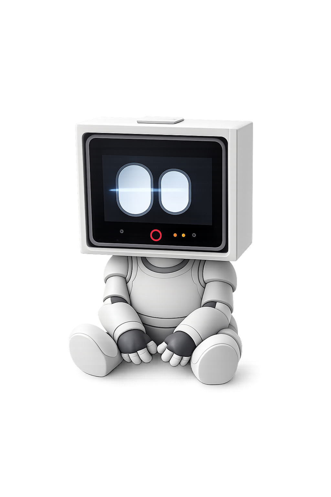

# 🤖 BOB by HomeVox

**Bad Or Brilliant. Usually both.**

<a href="#features">Features</a> &nbsp; · &nbsp; <a href="#installation">Setup</a> &nbsp; · &nbsp; <a href="#home-assistant">Home Assistant</a> &nbsp; · &nbsp; <a href="https://makerworld.com/en/models/2468752-bob-m5stack-cores3-lite-deskrobot">Print files</a>

---

BOB turns an **M5Stack CoreS3 / CoreS3 Lite** into a little desk companion. He looks around with big animated eyes, shows your Home Assistant notifications on his face and reacts when you touch him. Print his body on MakerWorld, flash the firmware, install the integration through HACS, and BOB becomes part of your smart home.

## ✨ Features

| Feature | What it does |
|---|---|
| Expressive eyes | Moods, blinking, looking around, falling asleep and waking up |
| Notifications | Show text from any Home Assistant automation on his face |
| HACS integration | Native BOB entities: switches, numbers, buttons, a mood selector, text and sensors |
| Services | `bob.send_text`, `bob.set_emotion`, `bob.run_action`, `bob.set_mode`, `bob.provision_ble_wifi` |
| Easy setup | Wi-Fi and MQTT through a web page on your phone, or via Bluetooth from Home Assistant |

## 🧰 What you need

- **M5Stack CoreS3** or **CoreS3 Lite**
- **Home Assistant** with **HACS**
- An **MQTT broker** (for example the Mosquitto add-on)
- The printed enclosure from [MakerWorld](https://makerworld.com/en/models/2468752-bob-m5stack-cores3-lite-deskrobot), 4 small round magnets and a USB-C cable

## 🔧 Installation

### 1. Install the integration (HACS)

1. Open HACS in Home Assistant.
2. Add the custom repository `https://github.com/HomeVox/Bob` with category **Integration**.
3. Install **Bob** and restart Home Assistant.
4. Add it under **Settings → Devices & services → Add integration → Bob**.

### 2. Flash the firmware

The firmware is in `firmware/bob`. In the Arduino IDE:

1. Add the board manager URL `https://static-cdn.m5stack.com/resource/arduino/package_m5stack_index.json`.
2. Install the **M5Stack** board package and select **M5Stack-CoreS3**. Do not use the M5AtomS3 profile.
3. Install the libraries **M5Unified**, **M5GFX**, **PubSubClient** and **ArduinoJson**.
4. Copy `firmware/bob/config.example.h` to `firmware/bob/config.h` (required). You can leave the placeholders: Wi-Fi and MQTT are set later on the setup page. `config.h` is ignored by git.
5. Open `firmware/bob/bob.ino` and upload.

### 3. Connect BOB

Without Wi-Fi details, BOB starts his own setup network:

1. Connect your phone or laptop to the Wi-Fi network **Bob-Setup**.
2. Open `http://192.168.4.1/setup` (http, not https).
3. Fill in your Wi-Fi and MQTT details and click **Save and Connect**.

Later you can open the same page at `http://bob.local/setup` or `http://<bob-ip>/setup`. Use the broker's IP address, port **1883**, and a username and password your broker accepts.

Prefer Bluetooth? Use the service `bob.provision_ble_wifi` from Home Assistant. BOB advertises as **Bob-Setup-BLE**.

## 🏠 Home Assistant

The integration adds a BOB device with:

- **Switches** – Always awake, Auto brightness, Matrix, Clock and more
- **Numbers** – Brightness, Sleep timer, Proximity threshold
- **Buttons** – Wake, Sleep, Follow, Snapshot, Yes/No
- **Select** – Emotion
- **Text** – Notification
- **Sensors** – State, Behaviour, Touch, Movement, Proximity and more

All services are described in `custom_components/bob/services.yaml`.

## 🩺 Troubleshooting

- **MQTT `rc=5`** – the broker rejected the username or password.
- **Setup page does not open** – make sure you are connected to `Bob-Setup` and use `http://192.168.4.1/setup`.
- **No entities yet** – restart Mosquitto and Home Assistant, then reload the Bob integration.

## 📁 Project files

- `custom_components/bob/` – Home Assistant integration (HACS)
- `firmware/bob/` – CoreS3 firmware
- `docs/images/` – images for this README

## 📄 License

MIT – see `LICENSE`.

**BOB by HomeVox. Bad or brilliant, but never boring.**
